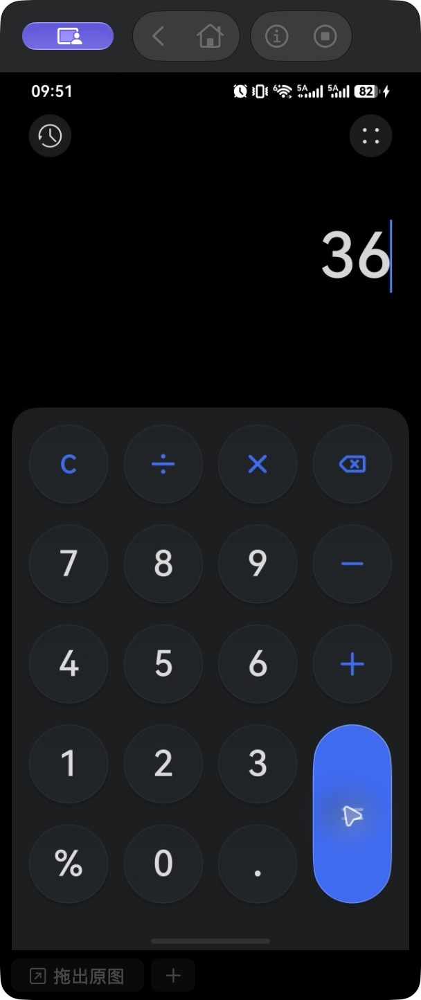
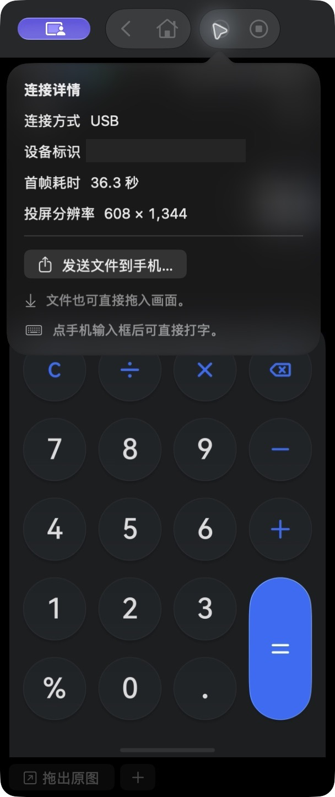

# HarmonyLink · 鸿蒙投屏

HarmonyLink 是一款面向 Apple 芯片 Mac 的鸿蒙投屏应用。用 USB 或同一局域网的 Wi‑Fi 连上手机，就能在 Mac 上看手机画面、用鼠标操作和键盘打字。你也可以把文件拖进手机，或者把图库里的原图拖到 Finder。已在原生鸿蒙 7.0 手机上实测。

## 实机截图

| USB 投屏与鼠标操作 | 连接详情与文件发送 |
| :---: | :---: |
|  |  |

## 功能

- USB 与 Wi‑Fi 投屏，支持调节窗口大小和无线画质。
- 用鼠标点击、滑动，通过 Mac 键盘输入文字。
- 从 Finder 拖文件到手机的「下载」目录。
- 从图库拖出单张或多张原图。打开照片后，点窗口底部的「＋」加入批量，再把「拖出 N 张原图」拖到 Mac 桌面或 Finder。

## 本地构建

需要 Apple 芯片 Mac、macOS 14 或更新版本、Xcode 命令行工具、Java 和华为设备连接工具 HDC。可以通过华为 Command Line Tools 或 DevEco Studio 安装 HDC。

从上游的 [dsh-hos-scrcpy 3.1.1 发布页](https://github.com/ns-zzj/dsh-hos-scrcpy/releases/tag/3.1.1) 下载 `nszzj-dsh-hos-scrcpy-3.1.1.tgz`。这个包提供投屏桥接组件。HarmonyLink 运行时直接启动该组件，不需要打开 DeepSeek Harness。

```bash
git clone https://github.com/phoenix0086/HarmonyLink.git
cd HarmonyLink

bridge_dir="$(mktemp -d)"
tar -xzf "$HOME/Downloads/nszzj-dsh-hos-scrcpy-3.1.1.tgz" -C "$bridge_dir"
BRIDGE_PACKAGE="$bridge_dir/package" bash build.sh
open dist/HarmonyLink.app
```

USB 模式下，在手机上解锁并授权 USB 调试。Wi‑Fi 模式下，在手机的开发者选项里查看无线调试地址，然后在应用中填入 `IP:端口`。

## 反馈与联系

遇到连接、操作或文件传输问题，欢迎添加作者微信 **`linhaoaiai`**，也可以在 [GitHub Issues](https://github.com/phoenix0086/HarmonyLink/issues) 反馈。反馈时请附上手机型号、鸿蒙版本、macOS 版本、连接方式以及能复现问题的操作步骤。

## 许可

HarmonyLink 自有源码、构建脚本、文档和图标公开供非商用使用。商用须取得版权方书面许可，详情见 [LICENSE](LICENSE)。

本仓库发布源码。桥接资源由 [dsh-hos-scrcpy](https://github.com/ns-zzj/dsh-hos-scrcpy) 提供，其随包声明也列出了 [HOScrcpy](https://gitcode.com/OpenHarmonyToolkitsPlaza/HOScrcpy) 的来源与许可说明。第三方组件各自适用上游条款。构建脚本会把上游随包的许可与第三方声明一并复制到本地应用。
